<div align="center">

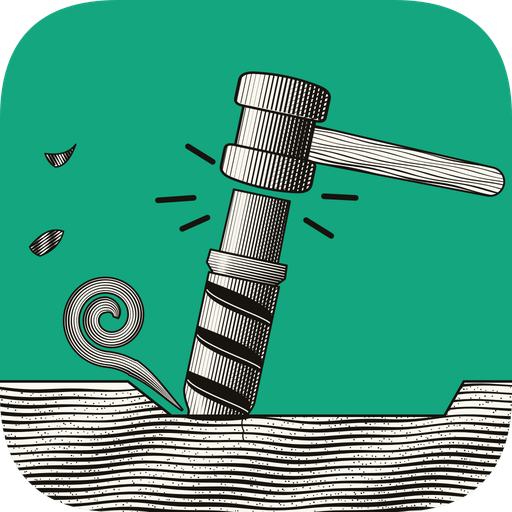

# Burin

**Design it, then carve it.**

A desktop program to draw parts, prepare toolpaths and write the control files of a CNC machine.

Linux · Windows · Browser · English · Français

**[Website](https://burin.cc/)** ·
**[Download](https://github.com/mornepousse/burin/releases/latest)** ·
**[Try it in your browser](https://burin.cc/app/)** ·
[Version française](README.fr.md)

</div>

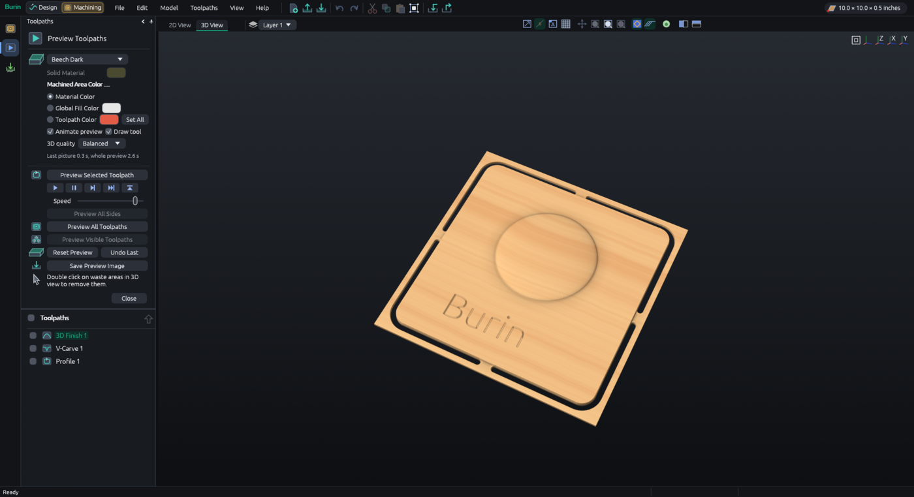

> [!WARNING]
> **Burin has never driven a real machine yet.** A mistake in a cutting file can break a bit or spoil
> a part. Check every file in a simulator, then run it in the air, with the bit well above the material,
> before you cut.

## What it does

| | |
|---|---|
| **Workspaces** | Two of them, switched from the top left: **Design** to draw and model, **Machining** for toolpaths, preview and machine files. Each keeps its panel on the left, opened from a strip of icons along the window's edge, and Burin goes to the right one when you open something of the other |
| **Finding your way** | A light "workshop" look or a dark one; a colour for each family of tools; **Ctrl+K** to find any command by name; a card giving the selection's position, size and layer, typed in directly; a start screen with drawings of recent projects and models to start from (name plaque, coaster, small box) |
| **Draw** | Lines, curves, arcs, circles, ellipses, rectangles, polygons, stars, spirals, text (the computer's fonts, bold, italic, alignment, and single-line fonts for engraving), dimensions, sketch constraints |
| **Edit** | Move, rotate and resize with the mouse (or type an exact value), offset, weld, trim, align, array copies, smooth outlines |
| **Organise** | Layers, groups, **pieces** (pick one hole without ungrouping, yet the piece moves as one), **several sheets** per job, nesting that adds sheets, turns parts, puts small parts in the holes of big ones, or fills an outline you choose |
| **Model** | 3D components, imported reliefs, clipart, sculpting, emboss, two-rail sweep, extrude and weave, copy of the visible model, a component's outline, cutting inside or outside shapes, model Z scale |
| **Machine** | Profile, pocket, drilling, engraving, V-carving, 3D roughing and finishing, prism, texture, moulding, fluting, chamfer |
| **Prepare** | Ramps, leads in and out, tabs, cutting order, merged toolpaths, reusable toolpath templates, two-tool pockets where the small tool clears what the big one can't reach, **adaptive clearing** (the bit never takes more than its stepover), slowing down in tight corners |
| **Compute** | A sum in any box (`W/2`, `T-0.1`…), and **document variables** (`{thickness}`): toolpath depths follow them when they change |
| **Check** | 3D preview of the cut (rapids, plunges and lifts in their own colours), time estimate, **check before cutting** (zero speeds, tool too short, rapids in the material, tabs too thin…), job sheet |
| **Resume** | After a stop, a file that starts again from a chosen pass of a toolpath |
| **Write** | Generic G-code, GRBL, Mach3, PlanetCNC, and your own `.pp` post processors |
| **Exchange** | Reads `.crv3d` projects (shapes, toolpaths, guides, grid, notes) and other programs' G-code, imports SVG, DXF, STL and pictures, exports SVG, EPS, AI, PDF, STL, prints through a PDF (paper size, real size over several pages or shrunk to one) |

What's still missing is listed at the end of this page.

## In pictures

<table>
<tr>
<td width="50%">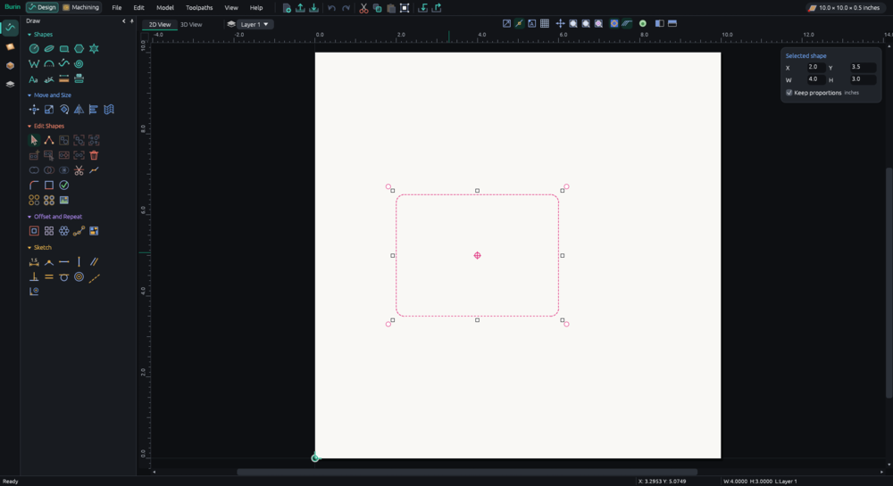<br><b>Handles</b>: click the selection to show them. <kbd>Alt</kbd> turns by 15°, <kbd>Shift</kbd> grows from the middle.</td>
<td width="50%">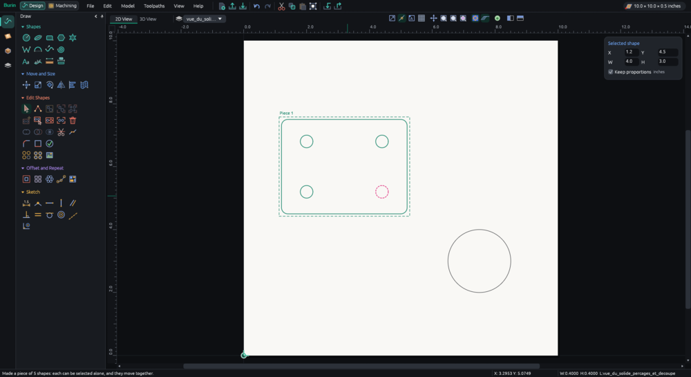<br><b>Pieces</b>: named, listed, and each can be saved to its own machine file.</td>
</tr>
<tr>
<td>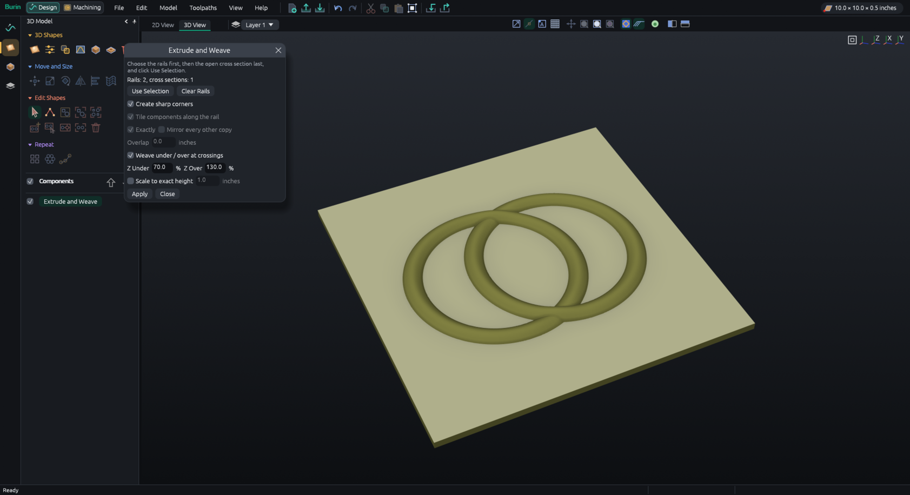<br><b>Extrude and weave</b>: a cross section along one or more rails, over and under where they cross.</td>
<td>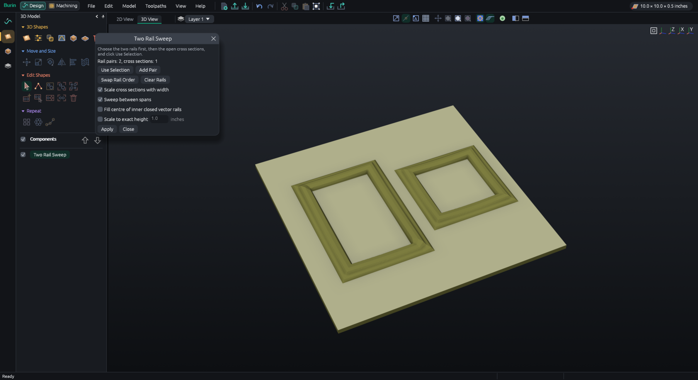<br><b>Two-rail sweep</b>: a moulding swept between pairs of rails.</td>
</tr>
<tr>
<td>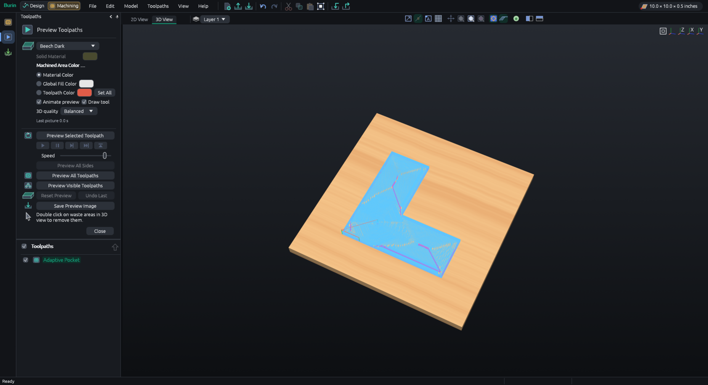<br><b>Adaptive clearing</b>: small steps that never bury the bit, coming down in a helix.</td>
<td>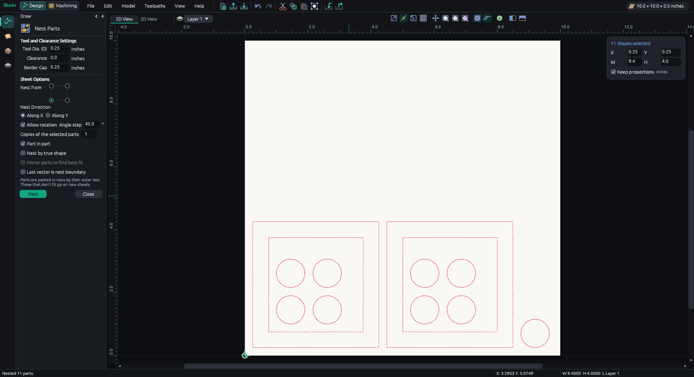<br><b>Nesting</b>: rows, turns, part in part, extra sheets when one is full.</td>
</tr>
<tr>
<td>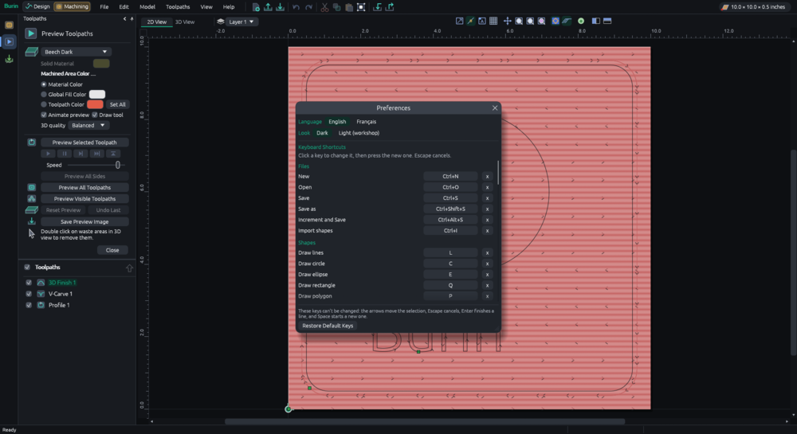<br><b>Preferences</b>: English or French, and every key can be changed.</td>
<td>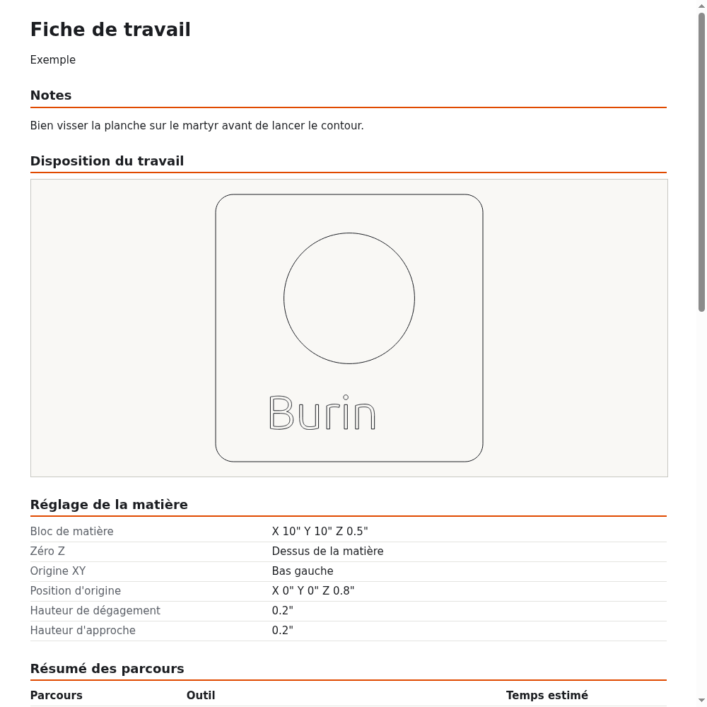<br><b>Job sheet</b>: the drawing, the material setup and every toolpath on one page.</td>
</tr>
</table>

## Install

Download the file for your computer from the
**[latest release](https://github.com/mornepousse/burin/releases/latest)**. Nothing else is needed.

### Windows

Run `Burin-*-windows-x86_64.exe`; there is nothing to install. It isn't signed, so Windows may ask for
confirmation (`More info > Run anyway`). It has only been tried under Wine and on one Windows 11 PC.

### Linux

```sh
chmod +x Burin-*-x86_64.AppImage
./Burin-*-x86_64.AppImage
```

Then `Help > Add to Applications Menu` puts Burin in your desktop's menu and lets it open `.burin`
files. A project can also be given as an argument, or dropped on the window.

### In a browser

**[burin.cc/app](https://burin.cc/app/)** runs Burin in the page.
Nothing is installed and nothing leaves the computer: everything is computed in the page.

What changes compared with the program:

- **Open** goes through the browser's file picker, or by dropping the file on the page.
- **Save** downloads the file: project, machine file, job sheet, picture.
- No automatic copy of unsaved work, no project backups and no crash reports: a browser doesn't let a
  page write to the disk. Save often.
- Long computations (the 3D preview of a big job) freeze the page while they run.
- Settings (language, keys, 3D view) are kept by the browser for this site. On the first visit, the
  language follows the browser's.
- **Print** downloads the PDF, to print from a PDF reader.

`release/web.sh` builds this version into `dist-web/`: a page and its files, to put as they are on any
web host.

### From the source

You need [Rust](https://rustup.rs).

```sh
cargo run --release
cargo test
```

`release/build.sh` builds the Linux and Windows programs, and `release/site.sh` the website.

## If something goes wrong

Unsaved work is copied every two minutes and offered at the next start if Burin didn't close properly.

| In the Help menu | |
|---|---|
| **Help Contents** | Nine short pages on each part of the program, offline |
| **Send Feedback** | A problem, an idea or a question |
| **Crash Reports** | What Burin noted when it stopped |
| **Support Details** | The version, the system, the graphics card and the last start, to copy |

**Burin sends nothing on its own.** Reports stay on your computer. If you choose to report one, a draft
opens in your browser: you see everything in it, and it only goes if you confirm it. Your work, its file
names and the name of your home folder are never in it.

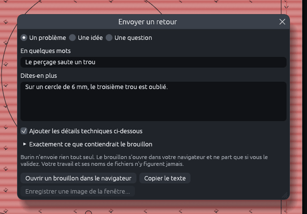

## Still missing

- **Real tests:** only a few jobs (profiles and a pocket) have been cut on a real machine so far. Check every file before cutting.
- **Menus:** some entries are still greyed out, mostly 3D modelling tools and views (coloured shaded
  view, wrapped rotary view).
- **Results:** toolpaths are not always the same as those saved in `.crv3d` projects, notably the cutting order and pockets,
  which lift the tool more often.

## The repository

| | |
|---|---|
| `src/` | The program, in Rust with [egui](https://github.com/emilk/egui) |
| `release/` | The logo and the scripts that build the programs, the web version and the website |
| `site/` | The website's page |
| `docs/` | The pictures on this page |

No real job file is included: `.gitignore` keeps projects and machine files out.

## Licence

Burin is free software, under the [GNU General Public License, version 3 or later](LICENSE)
(GPL-3.0-or-later). You may use, study, share and change it; if you share a changed version, you share
its source under the same licence. The list of the libraries used and their licences comes with every
release, in `THIRD-PARTY.txt`.
